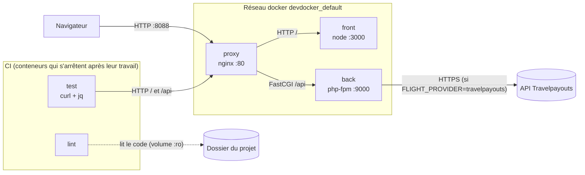
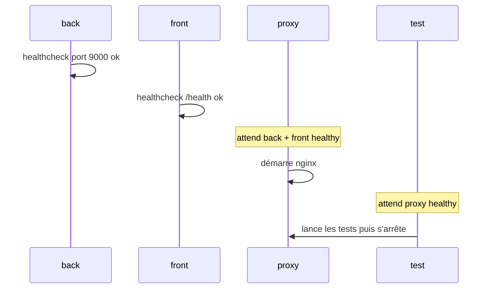
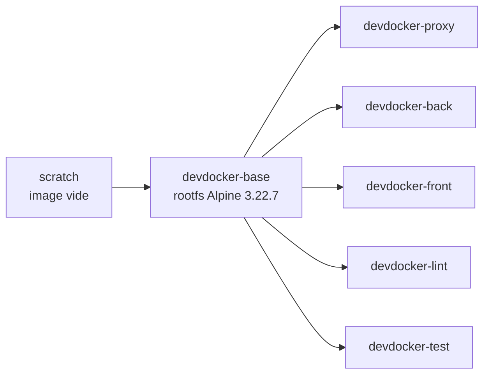

# Vols pas chers — Projet Docker Cloud

Site très simple : on donne une ville de départ, une ou plusieurs destinations et une période,
il affiche les vols triés du moins cher au plus cher.

| Service | Techno | Rôle |
|---|---|---|
| `front` | React (Vite) servi par Node | Formulaire de recherche |
| `back` | Symfony 7.4 sur PHP-FPM 8.3 | API `GET /api/flights`, `/api/airports`, `/api/health` |
| `proxy` | Nginx | Le « serveur web », point d'entrée unique : `/` → front, `/api` → back |
| `lint` | shellcheck, yamllint, php -l, ESLint | **CI** : vérifie la qualité du code de tout le projet |
| `test` | curl + jq | **CI** : tests de bout en bout de la stack à travers le proxy |

## Lancer

```sh
docker compose up -d --build
```

Puis ouvrir http://localhost:8088.

Par défaut les vols sont factices (`FLIGHT_PROVIDER=mock`). Pour de vrais vols, avec un lien direct vers la réservation
de chaque billet, créer un token gratuit sur travelpayouts.com puis un fichier `.env` à la racine (jamais commité) :

```sh
FLIGHT_PROVIDER=travelpayouts
TRAVELPAYOUTS_TOKEN=votre_token
```

`lint` et `test` se lancent aussi avec `up`, font leur travail puis s'arrêtent. Leur code de sortie donne le résultat
(0 = ok, 1 = échec) :

```sh
docker compose ps -a                # lint / test : Exited (0) = tout est bon
docker compose logs lint test       # le détail
docker compose run --rm lint        # relancer le lint seul (après avoir modifié le code)
docker compose run --rm test        # relancer les tests seuls
```

Toutes les autres variables décrites plus bas peuvent aussi être mises dans ce `.env` pour changer les ressources
sans toucher au compose.

## Architecture et communications



- Seul le `proxy` publie un port sur la machine (8088). `front` et `back` ne sont joignables que sur le réseau interne
  du compose, par leur nom de service (DNS docker `127.0.0.11`).
- Le navigateur charge le site React depuis `/`, puis le JavaScript appelle `/api/...` sur la même origine : pas besoin de CORS.
- Nginx parle au back en **FastCGI** (protocole de PHP-FPM), pas en HTTP : il n'y a pas de serveur web dans l'image back.
- `test` passe par le `proxy` comme un vrai navigateur : il teste donc toute la chaîne proxy → front / back.
- `lint` ne parle à aucun conteneur : il lit seulement le code du projet monté en lecture seule.

Ordre de démarrage : `base` est construite en premier (les autres images en dépendent), `back` et `front` démarrent,
`proxy` attend qu'ils soient **healthy** (`depends_on` + `condition: service_healthy`), et `test` attend à son tour
que le `proxy` soit healthy. `lint` n'a besoin de personne et tourne en parallèle.



## Les images

**Aucune image ne vient de Docker Hub**, même pas l'OS. On construit d'abord notre propre image de base `devdocker-base`
à partir de `scratch` (image vide), puis les trois images du projet partent de celle-ci.



### base (OS)

[base/Dockerfile](base/Dockerfile)

- `FROM scratch` : on part d'une image totalement vide.
- `ADD rootfs-${TARGETARCH}.tar.gz /` : on décompresse le **minirootfs officiel d'Alpine 3.22.7**, téléchargé sur
  [alpinelinux.org](https://alpinelinux.org/downloads/) (et pas sur Docker Hub). Les sommes SHA256 ont été vérifiées avec
  celles publiées par Alpine. `ADD` décompresse tout seul une archive locale.
- Il y a deux archives, `rootfs-arm64.tar.gz` (Mac M1/M2...) et `rootfs-amd64.tar.gz` (PC x86). `TARGETARCH` est rempli
  automatiquement par BuildKit, donc la bonne est choisie selon la machine. Testé sur les deux architectures.
- `ENV PATH=...` : une image `scratch` n'a aucune variable, on définit le `PATH` pour trouver les commandes.

Alpine a été choisie parce qu'elle fait environ 8 Mo, qu'elle a un gestionnaire de paquets (`apk`) avec des versions
récentes, et `--no-cache` évite de garder l'index des paquets dans l'image.

Dans le compose, le service `base` construit cette image. Les autres services la reçoivent avec
`additional_contexts: base: service:base` (le `FROM base` de leur Dockerfile), ce qui oblige compose à construire `base`
en premier. Le conteneur `base` lance juste `true` et s'arrête aussitôt (`Exited (0)`, c'est normal).

### proxy (serveur web)

[proxy/Dockerfile](proxy/Dockerfile)

**Dépendances installées**

| Paquet | Pourquoi |
|---|---|
| `nginx` | Le serveur web / reverse proxy |
| `gettext` | Fournit `envsubst`, qui remplace les variables `${...}` dans le template de config au démarrage |

**Opérations sur l'OS**

- Copie de [nginx.conf.template](proxy/nginx.conf.template) dans `/etc/nginx/`.
- Au démarrage, `envsubst` génère `/etc/nginx/nginx.conf` à partir du template. On liste explicitement les variables
  (`$NGINX_WORKER_PROCESSES $FRONT_PORT`) sinon `envsubst` effacerait aussi les variables nginx comme `$back` ou `$front`.
- `resolver 127.0.0.11` + `set $back ...` : nginx résout les noms des conteneurs à chaque requête au lieu d'une seule
  fois au démarrage, donc il ne plante pas si un conteneur redémarre et change d'IP.

**Port exposé** : `80` (HTTP).

**Entrypoint** : `ENTRYPOINT ["/entrypoint.sh"]` + `CMD ["nginx", "-g", "daemon off;"]`

[proxy/entrypoint.sh](proxy/entrypoint.sh) :
1. vérifie que `NGINX_WORKER_PROCESSES` et `FRONT_PORT` sont des nombres, sinon le conteneur s'arrête avec un message clair ;
2. génère `nginx.conf` avec `envsubst` ;
3. teste la config (`nginx -t`) avant de démarrer ;
4. `exec "$@"` lance le `CMD`.

- `daemon off;` : nginx reste au premier plan, sinon le conteneur s'arrêterait tout de suite.
- `exec` : nginx remplace le script et devient le PID 1, c'est donc lui qui reçoit les signaux de `docker stop`.

### back (API)

[back/Dockerfile](back/Dockerfile)

**Dépendances installées**

| Paquet | Pourquoi |
|---|---|
| `php83-fpm` | Le moteur PHP en mode FastCGI, qui exécute Symfony |
| `composer` | Installe les dépendances PHP (`vendor/`) pendant le build. Tire aussi `php83` (CLI), utilisé pour `bin/console` et le healthcheck |
| `php83-ctype`, `php83-iconv`, `php83-mbstring` | Extensions exigées par Symfony (gestion des chaînes, encodage UTF-8, `mb_strtolower` dans le contrôleur) |
| `php83-tokenizer` | Demandée par des composants Symfony (console, cache) pour analyser du code PHP |
| `php83-dom`, `php83-xml` | Utilisées par le composant Config de Symfony (`XmlUtils`) et exigées par certains paquets à l'installation |
| `php83-curl` | Utilisé par `symfony/http-client` pour appeler l'API Travelpayouts |

**Opérations sur l'OS**

- `composer install --no-dev` : installe seulement les dépendances de prod dans l'image (le `vendor/` local est exclu
  par [.dockerignore](back/.dockerignore), il est donc toujours reconstruit proprement).
- `bin/console cache:warmup` : prépare le cache Symfony au build pour que le premier appel soit rapide.
- `chown -R nobody var` : PHP-FPM tourne avec l'utilisateur `nobody` (pas root), il doit pouvoir écrire dans `var/` (cache, logs).
- Copie de [www.conf](back/www.conf) : config du pool FPM (`user = nobody`, `listen = 9000`, `pm = ondemand` pour ne
  lancer des workers que quand il y a des requêtes, `clear_env = no` pour que PHP voie les variables du conteneur).
  PHP-FPM remplace lui-même `${FPM_MAX_CHILDREN}` et `${PHP_MEMORY_LIMIT}` par les variables d'environnement.

**Port exposé** : `9000` (FastCGI, seulement sur le réseau interne).

**Entrypoint** : `ENTRYPOINT ["/entrypoint.sh"]` + `CMD ["php-fpm83", "-F"]`

[back/entrypoint.sh](back/entrypoint.sh) vérifie que `FPM_MAX_CHILDREN` est un nombre > 0 et que `PHP_MEMORY_LIMIT` a
la forme `64M`/`1G`, prévient si on demande `travelpayouts` sans token, affiche la config puis fait `exec "$@"`.

- `-F` : FPM reste au premier plan (pas de démon).
- Grâce à `exec`, `php-fpm83` devient le PID 1 à la place du script.

### front

[front/Dockerfile](front/Dockerfile)

**Dépendances installées**

| Paquet | Pourquoi |
|---|---|
| `nodejs` | Exécute le petit serveur [server.js](front/server.js) |
| `npm` | Installe Vite/React et compile le site pendant le build |

**Opérations sur l'OS**

- `npm ci` : installe exactement les versions de `package-lock.json` (build reproductible).
- `npm run build` : Vite compile React dans `dist/`.
- `node_modules` et `dist` locaux sont exclus par [.dockerignore](front/.dockerignore).
- [server.js](front/server.js) n'a aucune dépendance (module `http` de Node), il sert `dist/` et répond `ok` sur `/health`.

**Port exposé** : `3000` (variable `PORT`).

**Entrypoint** : `ENTRYPOINT ["/entrypoint.sh"]` + `CMD ["node", "server.js"]`

[front/entrypoint.sh](front/entrypoint.sh) vérifie que `PORT` et `NODE_MAX_MEMORY` sont des nombres, puis exporte
`NODE_OPTIONS=--max-old-space-size=$NODE_MAX_MEMORY` (node lit ses options dans cette variable) et fait `exec "$@"`
pour que node soit le PID 1.

### Pourquoi ENTRYPOINT + CMD

- L'`ENTRYPOINT` (le script) fait toujours la préparation : vérifier les arguments, générer la config.
- Le `CMD` est la commande lancée à la fin, on peut la remplacer sans perdre la préparation
  (ex. `docker run devdocker-proxy nginx -T` pour afficher la config générée).
- Un argument invalide fait échouer le conteneur dès le démarrage avec un message clair, au lieu d'un bug plus tard :

```sh
$ docker run --rm -e FPM_MAX_CHILDREN=abc devdocker-back
Erreur : FPM_MAX_CHILDREN doit être un nombre > 0 (reçu : 'abc')
```

## CI : lint et tests

Consigne supplémentaire : deux conteneurs de CI, construits eux aussi `FROM base` (rien de Docker Hub).

### lint

[ci/lint/Dockerfile](ci/lint/Dockerfile)

**Dépendances installées**

| Paquet | Pourquoi |
|---|---|
| `shellcheck` | Analyse les scripts shell (`entrypoint.sh`, scripts de CI) : variables non définies, guillemets oubliés... |
| `yamllint` | Vérifie le `docker-compose.yml` et la config Symfony (`back/config`) |
| `php83` | `php -l` vérifie la syntaxe de tous les fichiers PHP du back |
| `nodejs`, `npm` | Pour ESLint, qui analyse le front React et `server.js` |
| `eslint`, `eslint-plugin-react`, `globals` (npm) | Installés au build depuis [package.json](ci/lint/package.json), config dans [eslint.config.js](ci/lint/eslint.config.js) |

**Opérations sur l'OS**
- `npm install` dans `/lint` au build : les outils sont dans l'image, le code ne l'est pas.
- Le code du projet est **monté au run** en lecture seule (`.:/lint/code:ro`) : le lint ne peut rien modifier, et on n'a
  pas besoin de reconstruire l'image quand le code change.

**Entrypoint** : [ci/lint/entrypoint.sh](ci/lint/entrypoint.sh) vérifie que `NODE_MAX_MEMORY` est un nombre et que le
code est bien monté, puis lance [lint.sh](ci/lint/lint.sh). Ce script fait toutes les étapes même si l'une échoue (pour
voir toutes les erreurs d'un coup), puis sort en code 1 s'il y a eu au moins une erreur.

Le lint a d'ailleurs trouvé de vrais avertissements dans nos `entrypoint.sh` (variable assignée par `eval`, invisible pour
shellcheck), qu'on a corrigés. Exemple avec une erreur PHP volontaire :

```
== php -l (syntaxe PHP du back)
PHP Parse error:  syntax error, unexpected end of file ... in back/src/Broken.php on line 2
   ÉCHEC
lint : 1 étape(s) en échec
```

### test

[ci/test/Dockerfile](ci/test/Dockerfile)

**Dépendances installées**

| Paquet | Pourquoi |
|---|---|
| `curl` | Fait les requêtes HTTP vers la stack |
| `jq` | Lit les réponses JSON de l'API pour vérifier leur contenu |

**Entrypoint** : [ci/test/entrypoint.sh](ci/test/entrypoint.sh) vérifie `TARGET_URL` (doit commencer par `http://`) et
`TEST_TIMEOUT`, puis lance [tests.sh](ci/test/tests.sh) : 9 tests (pages du front, 404, `/api/health`, recherche
d'aéroports par nom et par code, erreurs 400 de `/api/flights`). Code de sortie 0 si tout passe, 1 sinon.

```
  ok    le front renvoie la page
  ok    l'API répond ok
  ok    recherche d'aéroport par nom
  ...
test : 9 réussi(s), 0 échoué(s)
```

Si on coupe le back (`docker compose stop back`), les tests de l'API passent en échec (HTTP 502) et le conteneur sort
en code 1 : c'est bien ce qu'on attend d'une CI.

## Arguments attendus au run

Toutes les images ont des valeurs par défaut (`ENV` dans le Dockerfile), surchargées par le compose, lui-même
surchargeable par le `.env` ou la ligne de commande (`FPM_MAX_CHILDREN=8 docker compose up -d`).

| Service | Variable | Défaut | Rôle |
|---|---|---|---|
| back | `FPM_MAX_CHILDREN` | 4 | Nombre max de workers PHP (= requêtes en parallèle) |
| back | `PHP_MEMORY_LIMIT` | 48M | Mémoire max par worker PHP |
| back | `FLIGHT_PROVIDER` | mock | `mock` = vols factices, `travelpayouts` = vraie API |
| back | `TRAVELPAYOUTS_TOKEN` | vide | Token de l'API (seulement en mode `travelpayouts`) |
| front | `FRONT_PORT` → `PORT` | 3000 | Port d'écoute du serveur Node |
| front | `NODE_MAX_MEMORY` | 96 | Taille max du tas JavaScript en Mo (`--max-old-space-size`) |
| proxy | `NGINX_WORKER_PROCESSES` | 2 | Nombre de process nginx (≈ nombre de CPU donnés) |
| proxy | `FRONT_PORT` | 3000 | Port du front, pour que nginx sache où l'appeler |
| proxy | `PROXY_PORT` | 8088 | Port publié sur la machine |
| lint | `LINT_NODE_MAX_MEMORY` → `NODE_MAX_MEMORY` | 128 | Mémoire max d'ESLint en Mo |
| test | `TEST_TARGET_URL` → `TARGET_URL` | http://proxy | Adresse de la stack à tester |
| test | `TEST_TIMEOUT` | 10 | Temps max d'une requête en secondes |

Équivalent en `docker run` pour une image seule, par exemple le back :

```sh
docker run -d --cpus=1 --memory=256m -e FPM_MAX_CHILDREN=4 -e PHP_MEMORY_LIMIT=48M devdocker-back
```

## Limitation des ressources

Chaque conteneur a une limite `deploy.resources.limits` (CPU + RAM), elle aussi réglable par variable.
Les limites sont choisies en cohérence avec les arguments applicatifs, pour que l'appli ne dépasse jamais sa limite
(sinon le noyau tue le process : OOM kill).

| Service | CPU (`*_CPUS`) | RAM (`*_MEMORY`) | Justification |
|---|---|---|---|
| back | 1 | 256M | 4 workers × 48M = 192M + le process maître FPM : ça tient dans 256M. Si on augmente `FPM_MAX_CHILDREN`, il faut augmenter `BACK_MEMORY` |
| front | 0.5 | 128M | Node est limité à 96M de tas, le reste sert au runtime Node lui-même. Il ne fait que servir des fichiers statiques donc peu de CPU |
| proxy | 0.5 | 64M | Nginx consomme très peu (quelques Mo par worker). 2 workers suffisent largement |
| lint | 1 | 256M | ESLint (128M de tas) + node, shellcheck et php tournent l'un après l'autre. Il ne tourne que quelques secondes |
| test | 0.25 | 32M | Juste `curl` et `jq` sur de petites réponses : quasiment rien |

## Gestion des signaux (SIGTERM)

`docker stop` / `docker compose down` envoie un signal au PID 1 du conteneur, attend `stop_grace_period` (10 s ici),
puis envoie SIGKILL. Pour que ça marche, chaque process principal est le PID 1 (grâce à `exec` ou à la forme JSON du `CMD`)
(le script d'entrypoint se remplace par la vraie commande avec `exec`, il ne reste pas entre docker et le process)
et sait s'arrêter proprement :

| Service | Signal | Comportement |
|---|---|---|
| front | SIGTERM (défaut) | Intercepté dans [server.js](front/server.js) : `server.close()` termine les requêtes en cours puis quitte |
| back | SIGQUIT (`STOPSIGNAL`) | Pour PHP-FPM, SIGTERM = arrêt brutal, SIGQUIT = arrêt **gracieux** (finit les requêtes en cours) |
| proxy | SIGQUIT (`STOPSIGNAL`) | Pour nginx, SIGTERM = arrêt rapide, SIGQUIT = arrêt **gracieux** |
| lint, test | SIGTERM (défaut) | Un `sh` en PID 1 **ignore** SIGTERM par défaut. Les scripts font donc `trap ... TERM` pour s'arrêter dès la fin de la requête en cours (code 143) |

Vérifié : `docker compose stop` arrête toute la stack en moins d'une seconde, sans attendre le SIGKILL.

## Healthchecks

| Service | Test |
|---|---|
| back | `php83 -r` ouvre une connexion sur le port 9000 (pas de curl dans l'image, PHP est déjà là) |
| front | `wget` (inclus dans busybox) sur `/health` |
| proxy | `wget` sur `/` |

## Pourquoi Docker plutôt que des VM

- **Léger** : un conteneur partage le noyau de la machine, pas d'OS complet à démarrer. Ici les 3 services démarrent en
  quelques secondes et sont limités à 448 Mo de RAM au total, là où 3 VM demanderaient chacune au moins 512 Mo.
- **Reproductible** : le Dockerfile décrit exactement l'installation, n'importe qui obtient la même image.
- **Isolé mais configurable** : limites CPU/RAM et variables d'environnement par conteneur, comme une VM mais sans hyperviseur.
- **Orchestration simple** : un seul `docker-compose.yml` décrit le réseau, l'ordre de démarrage et les ressources.
- **Pas besoin de Docker Hub** : on part de `scratch` et du rootfs officiel d'Alpine, et on installe soi-même ce qu'il faut.
