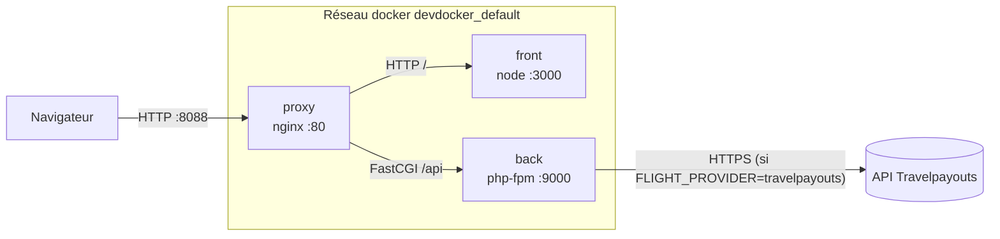
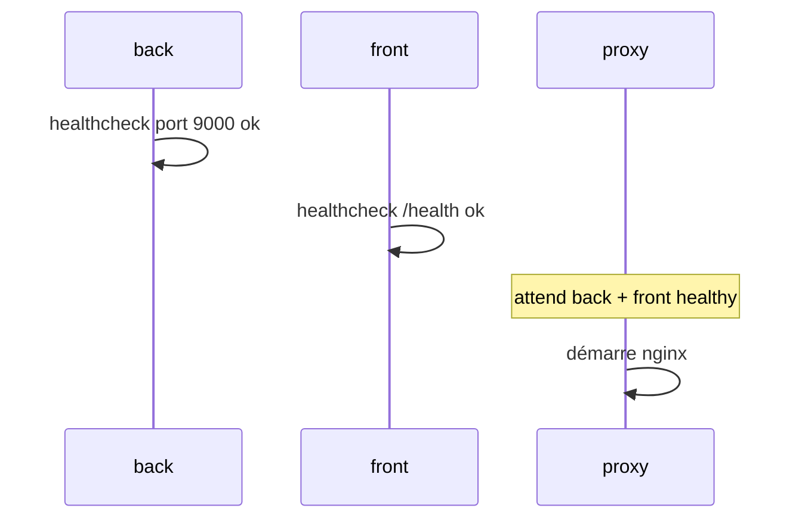

# Vols pas chers — Projet Docker Cloud

Site très simple : on donne une ville de départ, une ou plusieurs destinations et une période,
il affiche les vols triés du moins cher au plus cher.

| Service | Techno | Rôle |
|---|---|---|
| `front` | React (Vite) servi par Node | Formulaire de recherche |
| `back` | Symfony 7.4 sur PHP-FPM 8.3 | API `GET /api/flights`, `/api/airports`, `/api/health` |
| `proxy` | Nginx | Le « serveur web », point d'entrée unique : `/` → front, `/api` → back |

## Lancer

```sh
docker compose up -d --build
```

Puis ouvrir http://localhost:8088.

Par défaut les vols sont factices (`FLIGHT_PROVIDER=mock`). Pour de vrais vols, avec un lien direct vers la réservation
de chaque billet, créer un token gratuit sur travelpayouts.com puis un fichier `.env` à la racine (jamais commité) :

```sh
FLIGHT_PROVIDER=travelpayouts
TRAVELPAYOUTS_TOKEN=votre_token
```

Toutes les autres variables décrites plus bas peuvent aussi être mises dans ce `.env` pour changer les ressources
sans toucher au compose.

## Architecture et communications



- Seul le `proxy` publie un port sur la machine (8088). `front` et `back` ne sont joignables que sur le réseau interne
  du compose, par leur nom de service (DNS docker `127.0.0.11`).
- Le navigateur charge le site React depuis `/`, puis le JavaScript appelle `/api/...` sur la même origine : pas besoin de CORS.
- Nginx parle au back en **FastCGI** (protocole de PHP-FPM), pas en HTTP : il n'y a pas de serveur web dans l'image back.

Ordre de démarrage : `back` et `front` démarrent en premier, `proxy` attend qu'ils soient **healthy**
(`depends_on` + `condition: service_healthy`).



## Les images

Les trois images partent d'`alpine:3.22` et installent elles-mêmes tout ce dont elles ont besoin. Aucune image
« toute faite » (`nginx`, `php`, `node`...) n'est utilisée. Alpine a été choisie parce qu'elle fait environ 8 Mo, qu'elle
a un gestionnaire de paquets (`apk`) avec des versions récentes, et `--no-cache` évite de garder l'index des paquets dans l'image.

### proxy (serveur web)

[proxy/Dockerfile](proxy/Dockerfile)

**Dépendances installées**

| Paquet | Pourquoi |
|---|---|
| `nginx` | Le serveur web / reverse proxy |
| `gettext` | Fournit `envsubst`, qui remplace les variables `${...}` dans le template de config au démarrage |

**Opérations sur l'OS**

- Copie de [nginx.conf.template](proxy/nginx.conf.template) dans `/etc/nginx/`.
- Au démarrage, `envsubst` génère `/etc/nginx/nginx.conf` à partir du template. On liste explicitement les variables
  (`$NGINX_WORKER_PROCESSES $FRONT_PORT`) sinon `envsubst` effacerait aussi les variables nginx comme `$back` ou `$front`.
- `resolver 127.0.0.11` + `set $back ...` : nginx résout les noms des conteneurs à chaque requête au lieu d'une seule
  fois au démarrage, donc il ne plante pas si un conteneur redémarre et change d'IP.

**Port exposé** : `80` (HTTP).

**Entrypoint** : `CMD envsubst ... && exec nginx -g 'daemon off;'`
- `daemon off;` : nginx reste au premier plan, sinon le conteneur s'arrêterait tout de suite.
- `exec` : nginx remplace le shell et devient le PID 1, c'est donc lui qui reçoit les signaux de `docker stop`.

### back (API)

[back/Dockerfile](back/Dockerfile)

**Dépendances installées**

| Paquet | Pourquoi |
|---|---|
| `php83-fpm` | Le moteur PHP en mode FastCGI, qui exécute Symfony |
| `composer` | Installe les dépendances PHP (`vendor/`) pendant le build. Tire aussi `php83` (CLI), utilisé pour `bin/console` et le healthcheck |
| `php83-ctype`, `php83-iconv`, `php83-mbstring` | Extensions exigées par Symfony (gestion des chaînes, encodage UTF-8, `mb_strtolower` dans le contrôleur) |
| `php83-tokenizer` | Demandée par des composants Symfony (console, cache) pour analyser du code PHP |
| `php83-dom`, `php83-xml` | Utilisées par le composant Config de Symfony (`XmlUtils`) et exigées par certains paquets à l'installation |
| `php83-curl` | Utilisé par `symfony/http-client` pour appeler l'API Travelpayouts |

**Opérations sur l'OS**

- `composer install --no-dev` : installe seulement les dépendances de prod dans l'image (le `vendor/` local est exclu
  par [.dockerignore](back/.dockerignore), il est donc toujours reconstruit proprement).
- `bin/console cache:warmup` : prépare le cache Symfony au build pour que le premier appel soit rapide.
- `chown -R nobody var` : PHP-FPM tourne avec l'utilisateur `nobody` (pas root), il doit pouvoir écrire dans `var/` (cache, logs).
- Copie de [www.conf](back/www.conf) : config du pool FPM (`user = nobody`, `listen = 9000`, `pm = ondemand` pour ne
  lancer des workers que quand il y a des requêtes, `clear_env = no` pour que PHP voie les variables du conteneur).
  PHP-FPM remplace lui-même `${FPM_MAX_CHILDREN}` et `${PHP_MEMORY_LIMIT}` par les variables d'environnement.

**Port exposé** : `9000` (FastCGI, seulement sur le réseau interne).

**Entrypoint** : `CMD ["php-fpm83", "-F"]`
- `-F` : FPM reste au premier plan (pas de démon).
- Forme JSON (exec) : `php-fpm83` est directement le PID 1, sans shell.

### front

[front/Dockerfile](front/Dockerfile)

**Dépendances installées**

| Paquet | Pourquoi |
|---|---|
| `nodejs` | Exécute le petit serveur [server.js](front/server.js) |
| `npm` | Installe Vite/React et compile le site pendant le build |

**Opérations sur l'OS**

- `npm ci` : installe exactement les versions de `package-lock.json` (build reproductible).
- `npm run build` : Vite compile React dans `dist/`.
- `node_modules` et `dist` locaux sont exclus par [.dockerignore](front/.dockerignore).
- [server.js](front/server.js) n'a aucune dépendance (module `http` de Node), il sert `dist/` et répond `ok` sur `/health`.

**Port exposé** : `3000` (variable `PORT`).

**Entrypoint** : `CMD exec node --max-old-space-size=$NODE_MAX_MEMORY server.js`
- Forme shell pour pouvoir utiliser la variable `$NODE_MAX_MEMORY`, avec `exec` pour que node soit le PID 1.

## Arguments attendus au run

Toutes les images ont des valeurs par défaut (`ENV` dans le Dockerfile), surchargées par le compose, lui-même
surchargeable par le `.env` ou la ligne de commande (`FPM_MAX_CHILDREN=8 docker compose up -d`).

| Service | Variable | Défaut | Rôle |
|---|---|---|---|
| back | `FPM_MAX_CHILDREN` | 4 | Nombre max de workers PHP (= requêtes en parallèle) |
| back | `PHP_MEMORY_LIMIT` | 48M | Mémoire max par worker PHP |
| back | `FLIGHT_PROVIDER` | mock | `mock` = vols factices, `travelpayouts` = vraie API |
| back | `TRAVELPAYOUTS_TOKEN` | vide | Token de l'API (seulement en mode `travelpayouts`) |
| front | `FRONT_PORT` → `PORT` | 3000 | Port d'écoute du serveur Node |
| front | `NODE_MAX_MEMORY` | 96 | Taille max du tas JavaScript en Mo (`--max-old-space-size`) |
| proxy | `NGINX_WORKER_PROCESSES` | 2 | Nombre de process nginx (≈ nombre de CPU donnés) |
| proxy | `FRONT_PORT` | 3000 | Port du front, pour que nginx sache où l'appeler |
| proxy | `PROXY_PORT` | 8088 | Port publié sur la machine |

Équivalent en `docker run` pour une image seule, par exemple le back :

```sh
docker run -d --cpus=1 --memory=256m -e FPM_MAX_CHILDREN=4 -e PHP_MEMORY_LIMIT=48M devdocker-back
```

## Limitation des ressources

Chaque conteneur a une limite `deploy.resources.limits` (CPU + RAM), elle aussi réglable par variable.
Les limites sont choisies en cohérence avec les arguments applicatifs, pour que l'appli ne dépasse jamais sa limite
(sinon le noyau tue le process : OOM kill).

| Service | CPU (`*_CPUS`) | RAM (`*_MEMORY`) | Justification |
|---|---|---|---|
| back | 1 | 256M | 4 workers × 48M = 192M + le process maître FPM : ça tient dans 256M. Si on augmente `FPM_MAX_CHILDREN`, il faut augmenter `BACK_MEMORY` |
| front | 0.5 | 128M | Node est limité à 96M de tas, le reste sert au runtime Node lui-même. Il ne fait que servir des fichiers statiques donc peu de CPU |
| proxy | 0.5 | 64M | Nginx consomme très peu (quelques Mo par worker). 2 workers suffisent largement |

## Gestion des signaux (SIGTERM)

`docker stop` / `docker compose down` envoie un signal au PID 1 du conteneur, attend `stop_grace_period` (10 s ici),
puis envoie SIGKILL. Pour que ça marche, chaque process principal est le PID 1 (grâce à `exec` ou à la forme JSON du `CMD`)
et sait s'arrêter proprement :

| Service | Signal | Comportement |
|---|---|---|
| front | SIGTERM (défaut) | Intercepté dans [server.js](front/server.js) : `server.close()` termine les requêtes en cours puis quitte |
| back | SIGQUIT (`STOPSIGNAL`) | Pour PHP-FPM, SIGTERM = arrêt brutal, SIGQUIT = arrêt **gracieux** (finit les requêtes en cours) |
| proxy | SIGQUIT (`STOPSIGNAL`) | Pour nginx, SIGTERM = arrêt rapide, SIGQUIT = arrêt **gracieux** |

Vérifié : `docker compose stop` arrête toute la stack en moins d'une seconde, sans attendre le SIGKILL.

## Healthchecks

| Service | Test |
|---|---|
| back | `php83 -r` ouvre une connexion sur le port 9000 (pas de curl dans l'image, PHP est déjà là) |
| front | `wget` (inclus dans busybox) sur `/health` |
| proxy | `wget` sur `/` |

## Pourquoi Docker plutôt que des VM

- **Léger** : un conteneur partage le noyau de la machine, pas d'OS complet à démarrer. Ici les 3 services démarrent en
  quelques secondes et sont limités à 448 Mo de RAM au total, là où 3 VM demanderaient chacune au moins 512 Mo.
- **Reproductible** : le Dockerfile décrit exactement l'installation, n'importe qui obtient la même image.
- **Isolé mais configurable** : limites CPU/RAM et variables d'environnement par conteneur, comme une VM mais sans hyperviseur.
- **Orchestration simple** : un seul `docker-compose.yml` décrit le réseau, l'ordre de démarrage et les ressources.
- **Pas besoin de Docker Hub** : on part d'un OS minimal et on installe soi-même ce qu'il faut.
